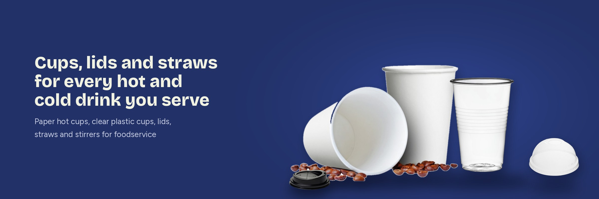
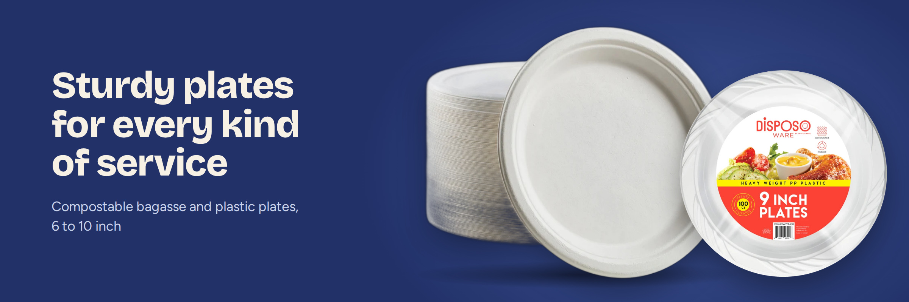
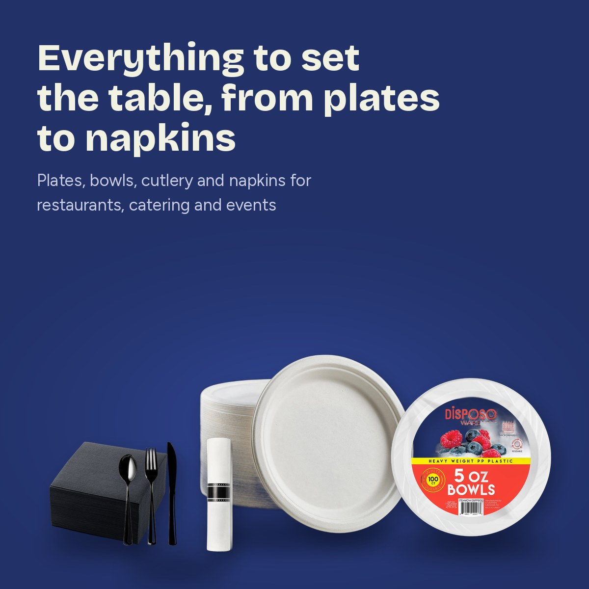
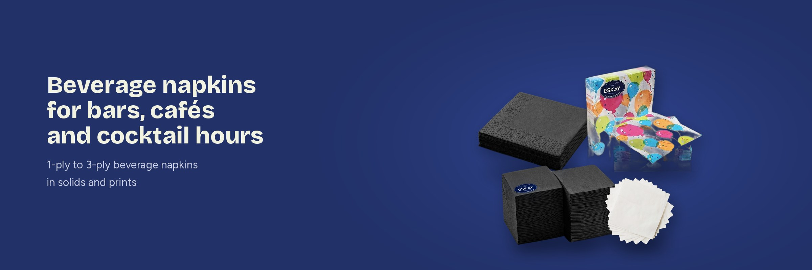
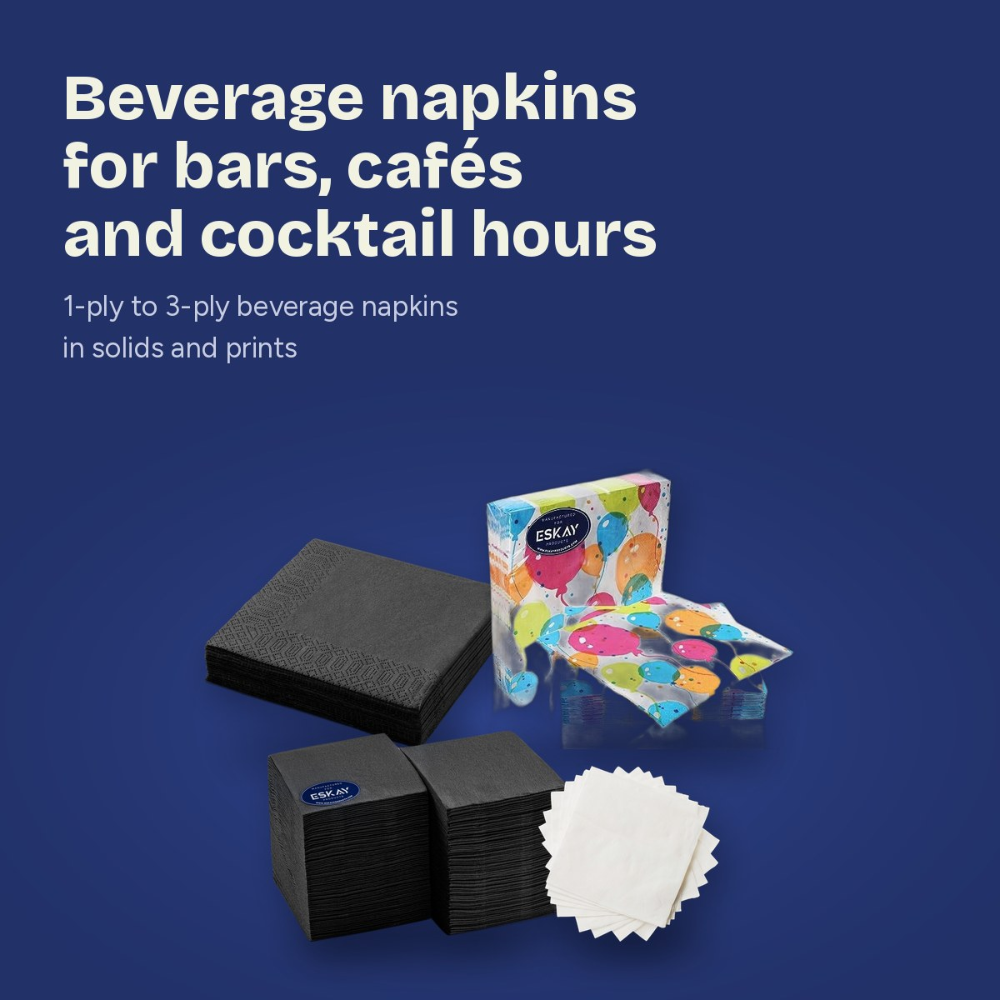
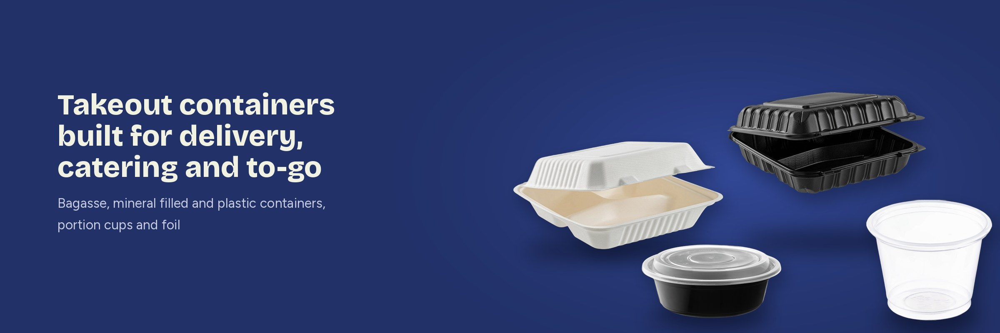
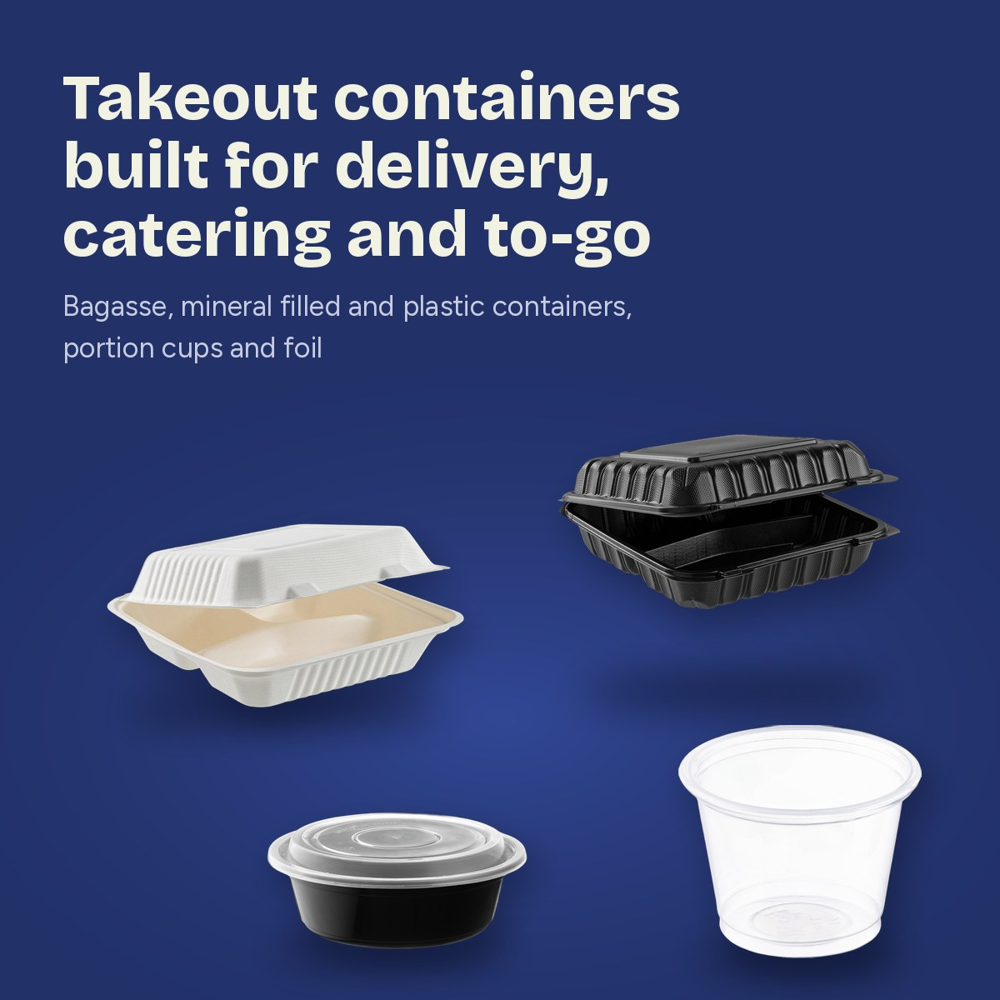

# Eskay Products: Shopify store revamp

[eskayproducts.com](https://eskayproducts.com/) is a US wholesale store for restaurant and foodservice disposables (cups, napkins, tableware, food packaging, janitorial supplies, safety apparel). I worked on the Shopify theme, the collection banners, email marketing and SEO.

All theme changes were built in a separate test theme first and shown to the client side by side with the live site before anything was published.

## What I did

| Area | Before | After |
|---|---|---|
| **Homepage hero** | Lifestyle photo, no H1 on the page | Real Eskay products on the brand yellow, headline set as the page H1 |
| **Shop-by-category cards** | Three different pastel colors | One navy brand style with product cut-outs |
| **Collection banners** | Stock photos with hotspot dots pointing to unrelated products | Branded navy banner per collection with a clear headline, plus a separate square banner for phones |
| **Collection SEO** | No heading above the product grid | H1 collection name + keyword H2 above the products, description moved below the grid |
| **Product page** | No reassurance near the button | Trust badges under *Add to cart* (free shipping, volume discount, factory-direct pricing, fast support) and a sticky *Add to cart* bar on mobile |
| **Cart** | Total only | Progress bar showing how far the customer is from free shipping and the volume discount |
| **Reviews** | Template placeholder text | Real verified customer reviews |
| **FAQ** | None | Homepage FAQ with Google FAQ structured data |
| **Footer** | Plain white | Navy footer matching the header, Blog link added |
| **Product descriptions** | Mixed Amazon formatting and font sizes | One consistent, readable style |
| **Google product data** | Broke on barcodes starting with 0 | Price, stock and barcode always readable by Google |
| **Klaviyo** | No review requests | Review request flow, campaigns, welcome offer |

Also: a blog, a supplier catalog import, and seasonal landing pages.

## Collection banners

Every collection got a desktop banner (2400 × 800) and a square mobile banner, all in the same navy style so the store reads as one brand.

| Desktop | Mobile |
|---|---|
|  |  |
|  |  |
|  |  |

All banners: [`banners/desktop`](banners/desktop) · [`banners/mobile`](banners/mobile) · [`banners/cards`](banners/cards) (homepage category cards).

## Testing

The storefront is covered by read-only Selenium smoke tests (search, collections, product page, *Add to cart* form, mobile layout) in [qa-automation](https://github.com/MilosG997/qa-automation).

## Tools

Shopify (Liquid, theme editor), Klaviyo, Google Search Console, Selenium + pytest.

---

Built by [Mechanically Gifted](https://mechanicallygifted.rs) · Shopify development, websites and QA automation.
